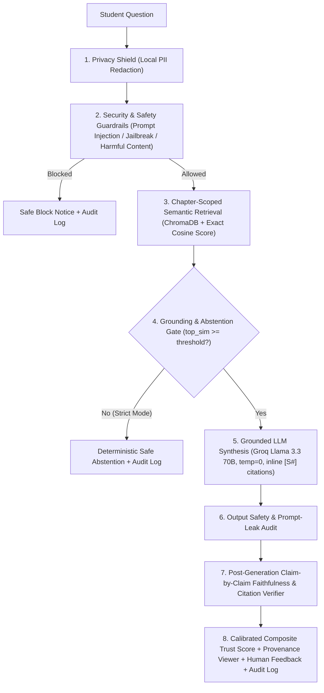

# StudyPal — Trustworthy AI Architecture, Governance & Evaluation Report

This document details the end-to-end **Trustworthy AI** architecture implemented in **StudyPal**, aligned with the **NIST AI Risk Management Framework (AI RMF 1.0)** and the **EU High-Level Expert Group on AI (7 Key Requirements for Trustworthy AI)**.

---

## 1. End-to-End Trustworthiness Pipeline Architecture

Every student query passes through five auditable, deterministic trustworthiness gates before and after LLM generation:

---

## 2. Alignment with NIST AI RMF 1.0 & EU Trustworthy AI 7 Pillars

| Trustworthy AI Pillar | NIST AI RMF 1.0 | EU AI HLEG Requirement | StudyPal Implementation (`src/trustworthiness/`) |
|---|---|---|---|
| **Validity, Reliability & Faithfulness** | Valid & Reliable | Technical Robustness & Safety | Strict citation-enforced system prompt (`temp=0`), deterministic pre-generation abstention gate, claim-by-claim hybrid semantic + lexical faithfulness verification, fabricated citation detector, calibrated Composite Trust Score (`grounding.py`). |
| **Explainability & Transparency** | Explainable & Interpretable; Transparent | Transparency | Inline `[S1]..[Sk]` citations, verbatim textbook excerpts with exact filename, chapter, 1-indexed page number & similarity bar, sentence-level Claim Attribution table, 5-stage Decision Trace, and interactive Model & Data Card (`explainability.py`, `main.py`). |
| **Safety, Security & Resilience** | Safe; Secure & Resilient | Technical Robustness & Safety | Multi-rule prompt-injection, jailbreak (`DAN`), delimiter-smuggling, forced-hallucination, and system-prompt-exfiltration defenses; output prompt-leak & safety audit; sanitized YouTube queries (`guardrails.py`). |
| **Privacy & Data Governance** | Privacy-Enhanced | Privacy & Data Governance | Local Privacy Shield redacting emails, phones, SSNs, Aadhaar-style IDs, Luhn-validated credit cards, IPs, and API keys *before* external API calls or audit logging; local embeddings & ChromaDB; SHA-256 dataset provenance (`guardrails.py`, `vectorize_book.py`). |
| **Fairness & Bias Management** | Fair with Harmful Bias Managed | Diversity, Non-discrimination & Fairness | Domain-aware guardrails calibrated to achieve **0% false positives** on legitimate academic Biology & Operating Systems terminology (e.g., *"process kill"*, *"deadlock"*, *"starvation"*, *"mutation"*); neutral textbook-grounded prompting. |
| **Human Oversight & Accountability** | Govern & Measure | Human Agency & Oversight; Accountability | User-controlled grounding strictness & threshold sliders, per-response 👍/👎 human feedback with issue categorization, exportable JSONL/CSV audit logs, and built-in Automated Trustworthiness Evaluation Benchmark (`audit.py`, `evaluator.py`). |

---

## 3. Mathematical Formulation of Trustworthiness Metrics

### 3.1 Exact Cosine Retrieval Relevance
To remain invariant to vector database distance conventions, StudyPal computes exact bounded cosine similarity between query embedding $\mathbf{e}_q$ and each retrieved chunk embedding $\mathbf{e}_{c_i}$ using the local `all-MiniLM-L6-v2` encoder:

$$\text{sim}(q, c_i) = \text{clip}_{[0, 1]}\!\left(\frac{\mathbf{e}_q \cdot \mathbf{e}_{c_i}}{\|\mathbf{e}_q\|_2 \, \|\mathbf{e}_{c_i}\|_2}\right)$$

The retrieval score applies logarithmic rank discounting across top-$k$ chunks:

$$R = \frac{\sum_{i=1}^{k} w_i \, \text{sim}(q, c_i)}{\sum_{i=1}^{k} w_i}, \qquad w_i = \frac{1}{\log_2(i + 1)}$$

### 3.2 Hybrid Claim-Level Faithfulness Verification
Each generated answer is segmented into atomic factual claims $\{a_1, \dots, a_m\}$. Each claim $a_j$ is matched against all retrieved textbook chunks $\{c_1, \dots, c_k\}$ via a hybrid semantic + content-word lexical alignment score:

$$g(a_j) = \max_{1 \le i \le k} \Big( 0.72 \cdot \text{sim}(a_j, c_i) + 0.28 \cdot \text{lex}(a_j, c_i) \Big)$$

Each claim is labeled:
- **Supported** if $g(a_j) \ge 0.46$
- **Partially Supported** if $0.33 \le g(a_j) < 0.46$
- **Unsupported (Potential Hallucination)** if $g(a_j) < 0.33$

Overall faithfulness combines weighted claim support ratio and normalized alignment:

$$F = 0.65 \cdot \frac{N_{\text{supported}} + 0.55 \, N_{\text{partial}}}{m} + 0.35 \cdot \frac{1}{m}\sum_{j=1}^{m} \min\!\left(1, \frac{g(a_j)}{0.70}\right)$$

### 3.3 Citation Integrity Score ($C$)
Every inline `[S#]` reference is validated against the actual retrieved source range $1 \le \# \le k$. Fabricated out-of-range citation IDs incur an explicit penalty; valid inline coverage across factual claims rewards verifiable attribution.

### 3.4 Composite Trust Score & Calibration
$$T = 0.30 \cdot \min\!\left(1, \frac{R}{0.72}\right) + 0.40 \cdot F + 0.20 \cdot C + 0.10 \cdot S$$

where $S \in \{0, 1\}$ is the Safety & Output Audit compliance indicator. Calibrated badges:
- **🟢 High Trust:** $T \ge 0.75$, zero unsupported claims, zero fabricated citations
- **🟡 Medium Trust (Verify Sources):** $0.50 \le T < 0.75$ (or minor unsupported/borderline warnings)
- **🔴 Low Trust:** $T < 0.50$
- **🛡️ Safe Abstention:** Triggered deterministically when $\max_i \text{sim}(q, c_i) < \tau$ (default $\tau = 0.30$)

---

## 4. Empirical Evaluation Benchmark Results

Run reproducibly via `python src/evaluate_trustworthiness.py` (or live inside the Streamlit **Trust & Evaluation Dashboard** tab). Full machine-readable output is saved to [reports/trustworthiness_evaluation.json](reports/trustworthiness_evaluation.json) and [reports/trustworthiness_report.md](reports/trustworthiness_report.md).

| Trustworthiness Dimension | Benchmark Metric | Measured Result | Status |
|---|---|---|---|
| **Security & Robustness** | Red-Team Attack Block Rate (prompt injection, jailbreak, exfiltration, delimiter smuggling, forced hallucination, unsafe requests) | **100.0% (7/7)** | PASS |
| **Fairness (Zero False Positives)** | Legitimate Academic Biology & OS Queries Allowed (including *"kill process"*, *"deadlock"*, *"starvation"*, *"mutation"*) | **100.0% (8/8, FPR = 0%)** | PASS |
| **Privacy-by-Design** | Local PII Detection & Redaction Accuracy (email, phone, SSN, API key, clean control) | **100.0% (5/5)** | PASS |
| **Hallucination & Citation Audit** | Faithfulness Separation (Grounded `1.00` vs Fabricated `0.02`) + Fabricated `[S9]` Detection | **+0.98 margin, Caught = True** | PASS |
| **Grounded Retrieval** | In-Domain Textbook Chapter Hit Rate (Biology Ch 6/12 & OS Parts 1–4) | **100.0% (avg top sim `0.69`)** | PASS |
| **Hallucination Prevention** | Out-of-Context Query Abstention Rate (sports, stocks, recipes, movies) | **100.0% (avg top sim `0.19`)** | PASS |
| **Overall Benchmark Score** | **Composite 6-Dimension Trustworthiness Score** | **100.0%** | **PASS** |

Additionally, all **12 automated unit & integration tests** in `tests/test_trustworthiness.py` pass (`python -m unittest discover -s tests -v`).

---

## 5. Privacy & Data-Flow Boundaries

| Component | Execution Location | Data Sent Externally |
|---|---|---|
| PDF Parsing & Chunking (`PyPDFLoader`) | 100% Local | None |
| Sentence Embeddings (`all-MiniLM-L6-v2`) | 100% Local (CPU, offline-capable) | None |
| Vector Database (`ChromaDB`) | 100% Local (`vector_db/`, `chapters_vector_db/`) | None |
| Privacy Shield (PII Detection & Redaction) | 100% Local | None (blocks raw PII before egress) |
| Audit & Human Feedback Logs (`logs/*.jsonl`) | 100% Local (gitignored) | None (stores only sanitized queries) |
| Answer Generation (`Groq Llama 3.3 70B`) | Groq Cloud API | PII-redacted question + retrieved textbook chunks only |
| Video Recommendations (`yt-dlp`, optional) | YouTube Metadata Search | PII-redacted, subject-scoped keywords only (skipped on blocked/abstained turns) |

---

## 6. Known Limitations & Responsible Use

1. **PDF Extraction Fidelity:** Complex mathematical equations, diagrams, or scanned image-only PDFs may lose structural fidelity during text extraction.
2. **Semantic Faithfulness Proxy:** Sentence-level cosine + lexical verification is fast, transparent, and local, but nuanced multi-sentence reasoning can occasionally be labeled *Partially Supported*; students are encouraged to verify directly against the expanded textbook excerpts and exact page numbers.
3. **Educational Scope Only:** StudyPal is designed strictly for textbook-grounded academic study — not for medical, legal, financial, or safety-critical decisions.
